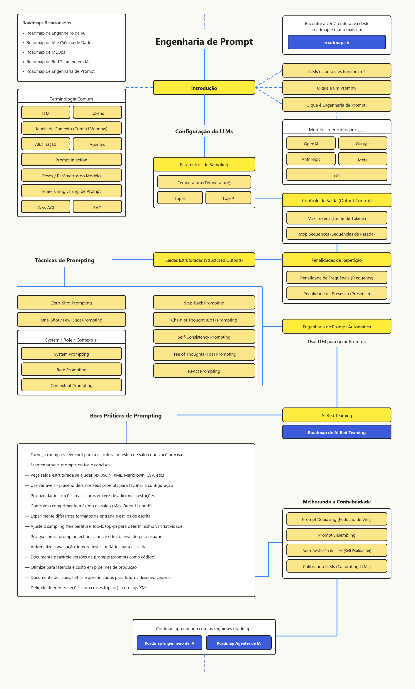
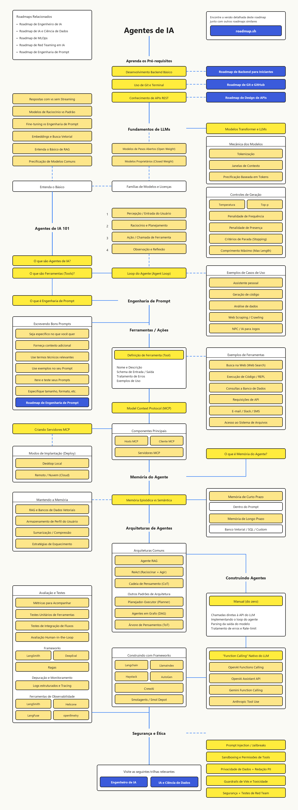
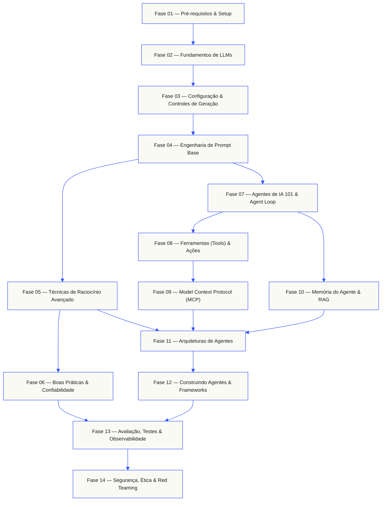

<p align="center">
  <picture>
    <source media="(prefers-color-scheme: dark)" srcset="assets/readme/header-dark.svg">
    
  </picture>
</p>

Domine os fundamentos de LLMs, engenharia de prompt, pipelines de RAG, protocolo MCP e arquiteturas de agentes autônomos. Estude a teoria no NotebookLM, implemente cada conceito em código e registre evidências práticas.

**[Começar a estudar](#rotas-de-estudo)** · **[Roadmaps visuais](#roadmaps-visuais)** · **[Caderno NotebookLM](#notebooklm)** · **[Explorar o currículo](#curriculo)**

Aberto, estruturado em português (PT-BR) e orientado à prática. Estude pelos roadmaps visuais, com tutoria no NotebookLM ou rodando código local.

> 2 trilhas completas. 14 fases. 85+ tópicos mapeados. Python, Prompt Engineering, RAG, MCP e Agentes de IA.

<p align="center">
  <a href="#roadmaps-visuais"></a>
  <a href="#curriculo"></a>
  <a href="#curriculo"></a>
  <a href="notebooklm/README.md"></a>
  <a href="https://github.com/vdornelass/ia-generativa-estudos/stargazers"></a>
</p>

<a id="rotas-de-estudo"></a>

## Rotas de estudo

Você não precisa ler todos os 85+ tópicos antes de começar. Escolha seu objetivo atual e siga a trilha correspondente:

| Seu objetivo | Ponto de partida | Roadmap de referência |
|---|---|---|
| Quero construir a base sólida de programação e APIs para IA | [Fase 01: Pré-requisitos & Setup](#fase-1) | [Agentes de IA (PDF)](roadmaps/ai-agents-roadmap-pt.pdf) |
| Quero dominar como LLMs funcionam, parâmetros e saídas estruturadas | [Fase 02: Fundamentos & Configuração de LLMs](#fase-2) | [Engenharia de Prompt (PDF)](roadmaps/prompt-engineering-roadmap-pt.pdf) |
| Quero escrever prompts profissionais, técnicas de raciocínio (CoT/ReAct) e evals | [Fase 03: Engenharia de Prompt Base](#fase-3) | [Engenharia de Prompt (PDF)](roadmaps/prompt-engineering-roadmap-pt.pdf) |
| Quero implementar RAG, memória vetorial e servidores MCP | [Fase 08: Model Context Protocol (MCP)](#fase-8) | [Agentes de IA (PDF)](roadmaps/ai-agents-roadmap-pt.pdf) |
| Quero construir agentes autônomos do zero e com LangGraph | [Fase 10: Arquiteturas de Agentes](#fase-10) | [Agentes de IA (PDF)](roadmaps/ai-agents-roadmap-pt.pdf) |

[Ver estrutura do repositório](#estrutura-do-repositorio) · [Como usar cada aula](#como-estudar)

---

<a id="roadmaps-visuais"></a>

## Roadmaps visuais (PT-BR)

Dois roadmaps completos traduzidos e desenhados em português, disponíveis em formato editável (`.excalidraw`), visual de alta resolução (`.pdf`) e texto estruturado para indexação semântica no NotebookLM (`.md`).

| Trilha | Visualização rápida | Arquivos no repositório |
|---|---|---|
| **01 · Engenharia de Prompt** | Fundamentos de LLMs, Sampling, Controle de Saída, Técnicas (Zero/Few-Shot, CoT, ToT, ReAct, APE), Boas Práticas e Confiabilidade | [PDF](roadmaps/prompt-engineering-roadmap-pt.pdf) · [Excalidraw](roadmaps/prompt-engineering-roadmap-pt.excalidraw) · [Markdown](notebooklm/fontes/prompt-engineering-roadmap-pt.md) |
| **02 · Agentes de IA** | Pré-requisitos, Mecânica de LLMs, Agent Loop, Tools, Protocolo MCP, Memória & RAG, Arquiteturas, Frameworks, Evals e Segurança | [PDF](roadmaps/ai-agents-roadmap-pt.pdf) · [Excalidraw](roadmaps/ai-agents-roadmap-pt.excalidraw) · [Markdown](notebooklm/fontes/ai-agents-roadmap-pt.md) |

<details>
<summary><strong>Visualizar diagrama — Roadmap 01: Engenharia de Prompt (PT-BR)</strong></summary>
<br/>
<p align="center">
  <a href="roadmaps/prompt-engineering-roadmap-pt.pdf">
    
  </a>
</p>
</details>

<details>
<summary><strong>Visualizar diagrama — Roadmap 02: Agentes de IA (PT-BR)</strong></summary>
<br/>
<p align="center">
  <a href="roadmaps/ai-agents-roadmap-pt.pdf">
    
  </a>
</p>
</details>

---

<a id="notebooklm"></a>

## Estudo assistido com NotebookLM

Este repositório mantém uma pasta dedicada ([`notebooklm/`](notebooklm/)) com versões em Markdown limpo dos roadmaps para alimentar seu caderno no **Google NotebookLM** sem ruído de coordenadas JSON ou falhas de OCR.

- **Caderno no NotebookLM**: `[Adicionar link do caderno compartilhado](https://notebooklm.google.com/)`
- **Fontes versionadas**: [`notebooklm/fontes/prompt-engineering-roadmap-pt.md`](notebooklm/fontes/prompt-engineering-roadmap-pt.md) · [`notebooklm/fontes/ai-agents-roadmap-pt.md`](notebooklm/fontes/ai-agents-roadmap-pt.md)
- **Artefatos exportados**: [`notebooklm/resumos-gerados/`](notebooklm/resumos-gerados/)

<details id="como-estudar">
<summary><strong>Use cada tópico da mesma forma (Ciclo de Estudo)</strong></summary>
<br/>

1. **Consulte o conceito** no [NotebookLM](notebooklm/README.md) e explique a ideia central com suas próprias palavras em [`anotacoes/`](anotacoes/).
2. **Implemente em código** dentro de [`exemplos-codigo/`](exemplos-codigo/) em vez de apenas ler sobre a técnica.
3. **Teste casos de borda**: mude parâmetros (`temperature`, `top_p`, schema JSON, falhas de tools) e observe onde o modelo quebra.
4. **Guarde a evidência**: salve o notebook/script, a saída obtida e marque o tópico como concluído no `.excalidraw`.

</details>

---

## A forma do currículo

Quatorze fases empilhadas em sequência lógica. Os fundamentos de backend e a mecânica dos LLMs formam o alicerce; engenharia de prompt e confiabilidade dão controle; ferramentas, MCP, memória e arquiteturas constroem os agentes; avaliação e segurança garantem produção.



---

<a id="curriculo"></a>

## Currículo completo

Quatorze fases mapeando todos os blocos dos dois roadmaps. Clique em qualquer fase para expandir seus tópicos.

<a id="fase-1"></a>
### Fase 01: Pré-requisitos & Setup `4 tópicos`
> Prepare a base de desenvolvimento backend, versionamento e comunicação via APIs antes de acoplar modelos.

| # | Tópico | Tipo | Ferramenta / Foco |
|:---:|--------|:----:|------|
| 01 | Desenvolvimento Backend Básico | Build | Python / TypeScript |
| 02 | Uso de Git, GitHub e Terminal | Learn | Git / Shell |
| 03 | Conhecimento de APIs REST e JSON | Build | HTTP / REST / JSON |
| 04 | Ambiente Virtual, Variáveis (`.env`) e Notebooks | Build | `venv` / JupyterLab |

<details id="fase-2">
<summary><b>Fase 02 — Fundamentos & Mecânica de LLMs</b> &nbsp;<code>14 tópicos</code>&nbsp; <em>Como modelos Transformer processam tokens, contexto, pesos e custos.</em></summary>
<br/>

| # | Tópico | Tipo | Roadmap |
|:---:|--------|:----:|------|
| 01 | Modelos Transformer e como LLMs funcionam | Learn | Prompt Eng. & Agentes |
| 02 | Tokenização e Tokens | Learn | Prompt Eng. & Agentes |
| 03 | Janelas de Contexto (Context Window) | Learn | Prompt Eng. & Agentes |
| 04 | Precificação Baseada em Tokens e Modelos Comuns | Learn | Agentes de IA |
| 05 | Pesos e Parâmetros do Modelo (Model Weights) | Learn | Engenharia de Prompt |
| 06 | Alucinação (Hallucination) | Learn | Engenharia de Prompt |
| 07 | Modelos de Pesos Abertos (Open Weight) vs Proprietários (Closed Weight) | Learn | Agentes de IA |
| 08 | Famílias de Modelos, Licenças e Provedores (OpenAI, Google, Anthropic, Meta, xAI) | Learn | Prompt Eng. & Agentes |
| 09 | Respostas com vs sem Streaming | Build | Agentes de IA |
| 10 | Modelos de Raciocínio (Reasoning) vs Modelos Padrão | Learn | Agentes de IA |
| 11 | Fine-Tuning vs Engenharia de Prompt | Learn | Prompt Eng. & Agentes |
| 12 | Embeddings e Busca Vetorial (Conceito Base) | Learn | Agentes de IA |
| 13 | Entenda o Básico de RAG (Retrieval-Augmented Generation) | Learn | Prompt Eng. & Agentes |
| 14 | Terminologia: IA vs AGI | Learn | Engenharia de Prompt |

</details>

<details id="fase-3">
<summary><b>Fase 03 — Configuração de LLMs & Controles de Geração</b> &nbsp;<code>8 tópicos</code>&nbsp; <em>Domine amostragem probabilística, limites de geração e saídas estruturadas.</em></summary>
<br/>

| # | Tópico | Tipo | Roadmap |
|:---:|--------|:----:|------|
| 01 | Parâmetros de Sampling: Temperatura (Temperature) | Build | Prompt Eng. & Agentes |
| 02 | Parâmetros de Sampling: Top-K | Build | Engenharia de Prompt |
| 03 | Parâmetros de Sampling: Top-P (Nucleus Sampling) | Build | Prompt Eng. & Agentes |
| 04 | Controle de Saída: Comprimento Máximo (Max Tokens / Max Length) | Build | Prompt Eng. & Agentes |
| 05 | Controle de Saída: Critérios e Sequências de Parada (Stop Sequences) | Build | Prompt Eng. & Agentes |
| 06 | Penalidades de Repetição: Penalidade de Frequência (Frequency Penalty) | Build | Prompt Eng. & Agentes |
| 07 | Penalidades de Repetição: Penalidade de Presença (Presence Penalty) | Build | Prompt Eng. & Agentes |
| 08 | Saídas Estruturadas (Structured Outputs: JSON, XML, Markdown, CSV) | Build | Engenharia de Prompt |

</details>

<details id="fase-4">
<summary><b>Fase 04 — Engenharia de Prompt Base</b> &nbsp;<code>7 tópicos</code>&nbsp; <em>Estruture instruções claras, papéis, contexto e exemplos.</em></summary>
<br/>

| # | Tópico | Tipo | Roadmap |
|:---:|--------|:----:|------|
| 01 | O que é um Prompt e o que é Engenharia de Prompt | Learn | Prompt Eng. & Agentes |
| 02 | Zero-Shot Prompting | Build | Engenharia de Prompt |
| 03 | One-Shot / Few-Shot Prompting | Build | Prompt Eng. & Agentes |
| 04 | System Prompting (Instruções de Sistema) | Build | Engenharia de Prompt |
| 05 | Role Prompting (Definição de Persona / Papel) | Build | Engenharia de Prompt |
| 06 | Contextual Prompting (Injeção de Contexto) | Build | Prompt Eng. & Agentes |
| 07 | Delimitadores (`XML tags` e ` ``` `) e Variáveis / Placeholders | Build | Engenharia de Prompt |

</details>

<details id="fase-5">
<summary><b>Fase 05 — Técnicas de Raciocínio Avançado & Automação</b> &nbsp;<code>6 tópicos</code>&nbsp; <em>Guie o modelo por múltiplos passos de raciocínio e gere prompts automaticamente.</em></summary>
<br/>

| # | Tópico | Tipo | Roadmap |
|:---:|--------|:----:|------|
| 01 | Step-back Prompting (Abstração antes da resposta) | Build | Engenharia de Prompt |
| 02 | Chain of Thought (CoT) Prompting (Cadeia de Pensamento) | Build | Prompt Eng. & Agentes |
| 03 | Self-Consistency Prompting (Consistência por múltiplos caminhos) | Build | Engenharia de Prompt |
| 04 | Tree of Thoughts (ToT) Prompting (Árvore de Pensamentos) | Build | Prompt Eng. & Agentes |
| 05 | ReAct Prompting (Reason + Act) | Build | Prompt Eng. & Agentes |
| 06 | Engenharia de Prompt Automática (APE — Usar LLM para gerar Prompts) | Build | Engenharia de Prompt |

</details>

<details id="fase-6">
<summary><b>Fase 06 — Boas Práticas de Prompting & Confiabilidade</b> &nbsp;<code>8 tópicos</code>&nbsp; <em>Reduza viés, versione prompts como código e calibre respostas.</em></summary>
<br/>

| # | Tópico | Tipo | Roadmap |
|:---:|--------|:----:|------|
| 01 | Prompts curtos, concisos e instruções claras em vez de restrições | Learn | Prompt Eng. & Agentes |
| 02 | Experimentação de formatos de entrada, tamanho e estilo de escrita | Build | Prompt Eng. & Agentes |
| 03 | Versionamento de Prompts (Prompts como Código) e documentação de decisões | Build | Engenharia de Prompt |
| 04 | Otimização de latência e custo em pipelines de produção | Build | Engenharia de Prompt |
| 05 | Prompt Debiasing (Redução de Viés) | Build | Engenharia de Prompt |
| 06 | Prompt Ensembling | Build | Engenharia de Prompt |
| 07 | Auto-Avaliação do LLM (LLM Self-Evaluation / LLM-as-a-Judge) | Build | Engenharia de Prompt |
| 08 | Calibrando LLMs (Calibrating LLMs) | Build | Engenharia de Prompt |

</details>

<details id="fase-7">
<summary><b>Fase 07 — Agentes de IA 101 & Loop do Agente</b> &nbsp;<code>7 tópicos</code>&nbsp; <em>O ciclo fundamental de percepção, raciocínio, ação e observação.</em></summary>
<br/>

| # | Tópico | Tipo | Roadmap |
|:---:|--------|:----:|------|
| 01 | O que são Agentes de IA? | Learn | Agentes de IA |
| 02 | O que são Ferramentas (Tools)? | Learn | Agentes de IA |
| 03 | Passo 1 do Loop: Percepção / Entrada do Usuário | Build | Agentes de IA |
| 04 | Passo 2 do Loop: Raciocínio e Planejamento | Build | Agentes de IA |
| 05 | Passo 3 do Loop: Ação / Chamada de Ferramenta | Build | Agentes de IA |
| 06 | Passo 4 do Loop: Observação e Reflexão | Build | Agentes de IA |
| 07 | Casos de Uso: Assistente Pessoal, Código, Dados, Web Scraping e NPCs | Learn | Agentes de IA |

</details>

<details id="fase-8">
<summary><b>Fase 08 — Ferramentas (Tools) & Ações</b> &nbsp;<code>7 tópicos</code>&nbsp; <em>Conecte modelos ao mundo externo com schemas rigorosos e tratamento de falhas.</em></summary>
<br/>

| # | Tópico | Tipo | Roadmap |
|:---:|--------|:----:|------|
| 01 | Definição de Ferramenta: Nome, Descrição, Schema de Entrada/Saída e Erros | Build | Agentes de IA |
| 02 | Busca na Web (Web Search) | Build | Agentes de IA |
| 03 | Execução de Código / REPL | Build | Agentes de IA |
| 04 | Consultas a Banco de Dados | Build | Agentes de IA |
| 05 | Requisições de API Externa | Build | Agentes de IA |
| 06 | Integrações de Comunicação (E-mail / Slack / SMS) | Build | Agentes de IA |
| 07 | Acesso ao Sistema de Arquivos (File System) | Build | Agentes de IA |

</details>

<details id="fase-9">
<summary><b>Fase 09 — Model Context Protocol (MCP)</b> &nbsp;<code>5 tópicos</code>&nbsp; <em>Padronize a comunicação entre hosts de IA, clientes e servidores de contexto.</em></summary>
<br/>

| # | Tópico | Tipo | Roadmap |
|:---:|--------|:----:|------|
| 01 | Arquitetura do Model Context Protocol (MCP) | Learn | Agentes de IA |
| 02 | Componentes Principais: Hosts MCP, Cliente MCP e Servidores MCP | Learn | Agentes de IA |
| 03 | Criando Servidores MCP Customizados | Build | Agentes de IA |
| 04 | Implantação em Desktop Local (`stdio`) | Build | Agentes de IA |
| 05 | Implantação Remota / Nuvem (`Cloud`) | Build | Agentes de IA |

</details>

<details id="fase-10">
<summary><b>Fase 10 — Memória do Agente & RAG</b> &nbsp;<code>8 tópicos</code>&nbsp; <em>Gerencie estado de curto prazo, memória semântica/episódica e bancos vetoriais.</em></summary>
<br/>

| # | Tópico | Tipo | Roadmap |
|:---:|--------|:----:|------|
| 01 | O que é Memória do Agente? | Learn | Agentes de IA |
| 02 | Memória Episódica vs Memória Semântica | Learn | Agentes de IA |
| 03 | Memória de Curto Prazo (Dentro do Prompt) | Build | Agentes de IA |
| 04 | Memória de Longo Prazo (Banco Vetorial / SQL / Custom) | Build | Agentes de IA |
| 05 | Mantendo a Memória: RAG e Bancos de Dados Vetoriais | Build | Agentes de IA |
| 06 | Armazenamento de Perfil do Usuário | Build | Agentes de IA |
| 07 | Sumarização e Compressão de Contexto | Build | Agentes de IA |
| 08 | Estratégias de Esquecimento (Forgetting) | Build | Agentes de IA |

</details>

<details id="fase-11">
<summary><b>Fase 11 — Arquiteturas de Agentes</b> &nbsp;<code>6 tópicos</code>&nbsp; <em>Padrões arquiteturais para raciocínio, planejamento e execução em grafo.</em></summary>
<br/>

| # | Tópico | Tipo | Roadmap |
|:---:|--------|:----:|------|
| 01 | Agente RAG (Agentic RAG) | Build | Agentes de IA |
| 02 | Arquitetura ReAct (Raciocinar + Agir) | Build | Agentes de IA |
| 03 | Cadeia de Pensamento (CoT) em Agentes | Build | Agentes de IA |
| 04 | Padrão Planejador-Executor (Planner-Executor) | Build | Agentes de IA |
| 05 | Agentes em Grafo (DAG / State Graph) | Build | Agentes de IA |
| 06 | Árvore de Pensamentos (ToT) em Agentes | Build | Agentes de IA |

</details>

<details id="fase-12">
<summary><b>Fase 12 — Construindo Agentes: Do Zero a Frameworks</b> &nbsp;<code>11 tópicos</code>&nbsp; <em>Implemente na unha, use Function Calling nativo e escale com frameworks.</em></summary>
<br/>

| # | Tópico | Tipo | Roadmap |
|:---:|--------|:----:|------|
| 01 | Construção Manual (Do Zero): Chamadas diretas, Loop, Parsing e Rate-limit | Build | Agentes de IA |
| 02 | Function Calling Nativo: OpenAI Functions Calling | Build | Agentes de IA |
| 03 | Function Calling Nativo: OpenAI Assistant / Agents API | Build | Agentes de IA |
| 04 | Function Calling Nativo: Gemini Function Calling | Build | Agentes de IA |
| 05 | Function Calling Nativo: Anthropic Tool Use | Build | Agentes de IA |
| 06 | Frameworks: LangChain & LangGraph | Build | Agentes de IA |
| 07 | Frameworks: LlamaIndex | Build | Agentes de IA |
| 08 | Frameworks: Haystack | Build | Agentes de IA |
| 09 | Frameworks: AutoGen | Build | Agentes de IA |
| 10 | Frameworks: CrewAI | Build | Agentes de IA |
| 11 | Frameworks: Smolagents / Smol Depot | Build | Agentes de IA |

</details>

<details id="fase-13">
<summary><b>Fase 13 — Avaliação, Testes & Observabilidade</b> &nbsp;<code>12 tópicos</code>&nbsp; <em>Meça regressões, audite trajetórias e monitore chamadas em produção.</em></summary>
<br/>

| # | Tópico | Tipo | Roadmap |
|:---:|--------|:----:|------|
| 01 | Métricas para Acompanhar em Agentes e LLMs | Learn | Agentes de IA |
| 02 | Testes Unitários de Ferramentas e de Saídas | Build | Prompt Eng. & Agentes |
| 03 | Testes de Integração de Fluxos | Build | Agentes de IA |
| 04 | Avaliação Human-in-the-Loop | Build | Agentes de IA |
| 05 | Framework de Avaliação: LangSmith | Build | Agentes de IA |
| 06 | Framework de Avaliação: DeepEval | Build | Agentes de IA |
| 07 | Framework de Avaliação: Ragas | Build | Agentes de IA |
| 08 | Depuração e Monitoramento: Logs Estruturados e Tracing | Build | Agentes de IA |
| 09 | Observabilidade: LangSmith | Build | Agentes de IA |
| 10 | Observabilidade: Helicone | Build | Agentes de IA |
| 11 | Observabilidade: LangFuse | Build | Agentes de IA |
| 12 | Observabilidade: OpenLLMetry | Build | Agentes de IA |

</details>

<details id="fase-14">
<summary><b>Fase 14 — Segurança, Ética & AI Red Teaming</b> &nbsp;<code>5 tópicos</code>&nbsp; <em>Proteja agentes contra prompt injection, vazamento de dados e execução indevida.</em></summary>
<br/>

| # | Tópico | Tipo | Roadmap |
|:---:|--------|:----:|------|
| 01 | Prompt Injection / Jailbreaks e Sanitização de Entrada | Build | Prompt Eng. & Agentes |
| 02 | Sandboxing e Permissões Mínimas de Tools | Build | Agentes de IA |
| 03 | Privacidade de Dados + Redação de PII (LGPD) | Build | Agentes de IA |
| 04 | Guardrails de Viés e Toxicidade | Build | Agentes de IA |
| 05 | Segurança + Testes de AI Red Teaming | Build | Prompt Eng. & Agentes |

</details>

---

<a id="estrutura-do-repositorio"></a>

## Estrutura do repositório e setup local

```text
ia-generativa-estudos/
├── assets/readme/                   # Banners SVG adaptativos (light/dark) e previews dos roadmaps
├── roadmaps/                        # Diagramas visuais (.excalidraw e .pdf em PT-BR)
├── notebooklm/                      # Fontes em Markdown (.md) e resumos do Google NotebookLM
├── anotacoes/                       # Caderno de anotações teóricas por fase
├── exemplos-codigo/                 # Laboratórios práticos e notebooks (.ipynb)
└── projetos/                        # Projetos práticos das 4 etapas de consolidação
```

```powershell
git clone https://github.com/vdornelass/ia-generativa-estudos.git
cd ia-generativa-estudos
python -m venv .venv
.\.venv\Scripts\Activate.ps1
pip install -r requirements.txt
Copy-Item .env.example .env
```
